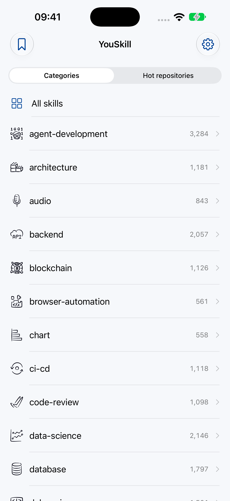
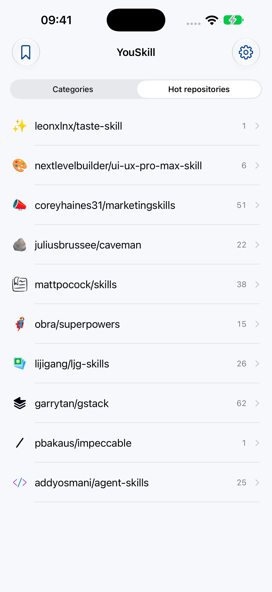
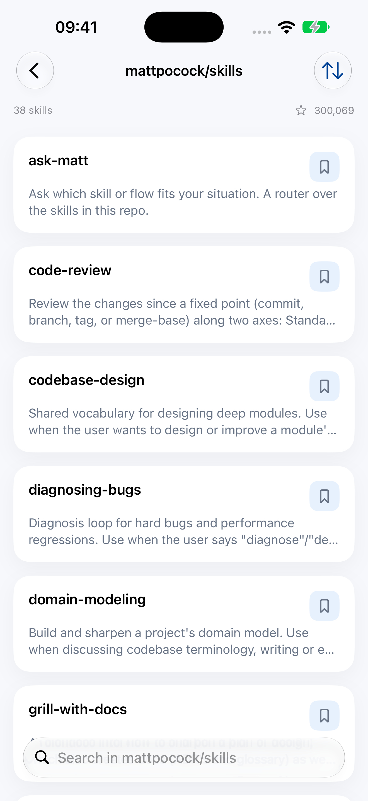
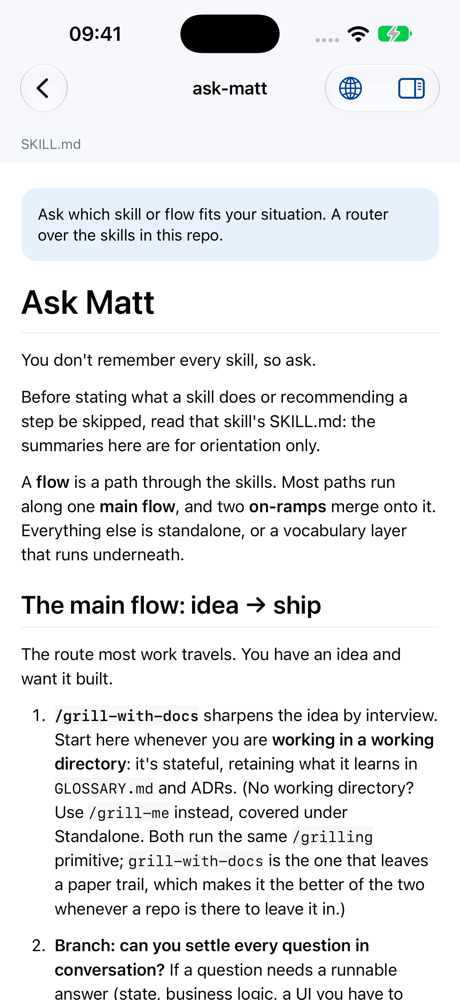
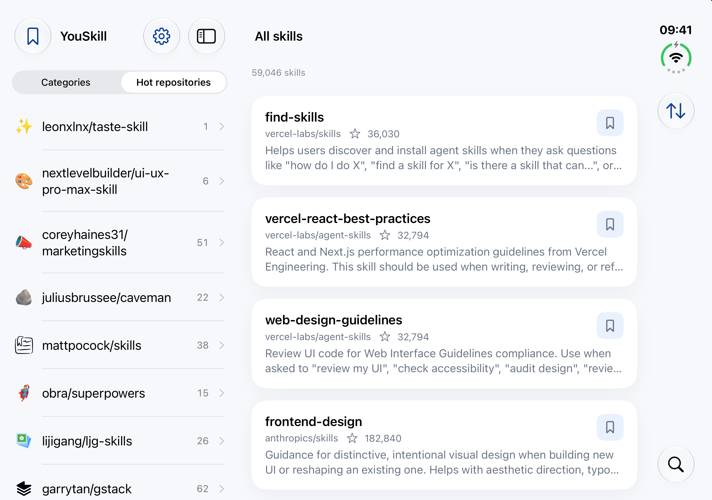
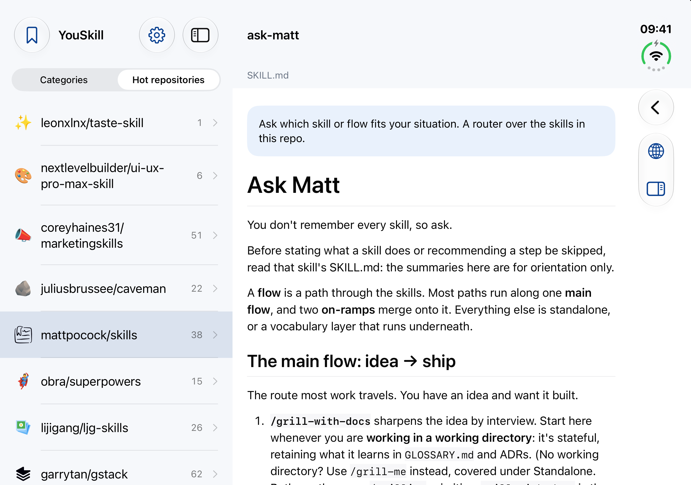

# YouSkill

Discover and read Agent Skills on your iPhone.

YouSkill helps you browse, search, and read MCP (Model Context Protocol) Skills with syntax-highlighted code preview and built-in translation.

## Screenshots

Version 1.1: browse categories and popular repositories, explore skills, and read their files.

  
  
  
  

  
  

## Download

## Features

- Browse and search Agent Skills
- Syntax-highlighted code preview for 30+ languages
- Markdown rendering with rich formatting
- Built-in translation powered by Chat Completion APIs
- File tree navigation with directory structure
- Bookmark your favorite Skills
- Multi-language support: English, 简体中文, 日本語, 한국어

## Tech Stack

- **Language**: Swift 6 with strict concurrency
- **UI**: SwiftUI
- **Minimum Target**: iOS 17.0
- **Architecture**: Layered domain architecture
- **Dependencies**:
  - [MarkdownUI](https://github.com/gonzalezreal/swift-markdown-ui) — Markdown rendering
  - [HighlightSwift](https://github.com/appstefan/highlightswift) — Syntax highlighting
- **Build**: [XcodeGen](https://github.com/yonaskolb/XcodeGen) for project generation

## Related Projects

- [YouSkill Desktop](https://github.com/wanggang316/you-skill) — macOS / Windows desktop app
- [youskill.cc](https://youskill.cc) — Official website

## License

This project is licensed under the [MIT License](LICENSE).
